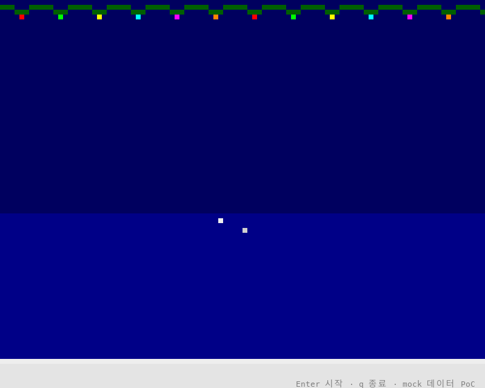

# 🎄 MERRY BUGMAS — Ops Christmas Market



운영 지표를 **크리스마스 마켓 게임**으로 보는 터미널 대시보드.
트래픽은 상점 앞에 선 손님 줄로, Sentry 미해결 이슈는 쥐로, sentry-bot 에이전트는 쥐를 잡는 호두까기 병정으로 그린다.
화면은 전부 반블록 문자 `▀` 로 그린 픽셀아트다. **지금은 mock 데이터 PoC.**

```bash
python3 xmas_market.py          # 대시보드 (60x22 이상, 256색, 의존성 없음)
./run-with-codex.sh             # 왼쪽 Codex 채팅 + 오른쪽 대시보드 (tmux 분할, 없으면 Terminal 창 2개)
```

| 운영 지표 | 마켓 장면 |
|---|---|
| 트래픽 rps (Grafana 자리) | 상점 앞 대기열. 한산함 → 활기참 → 북적북적 → 인파 경보 |
| Sentry 미해결 이슈 | 호두까기 인형의 쥐 (머리 위 라벨이 이슈 ID) |
| sentry-bot 서브 에이전트 | 호두까기 병정 셋 — `1 루돌프` · `2 진저` · `3 호두`. 채팅 명령을 알아듣는다 |

## 게임처럼 진행한다

### 1. 타이틀
눈발이 점점 굵어지다가 가운데가 걷히며 `MERRY BUGMAS` 가 나온다. 아래 눈밭에서는 병정이 쥐를 쫓는다. 아무 키나 누르면 메뉴로.

### 2. 스테이지 고르기


① **서비스**(ALL · WEB · SEARCH · RESUME · DISPLAY · MOBILE)를 고르고 ② **시나리오**(🎄 트래픽 / 🐭 Sentry 버그 / 📊 개요)를 고른 뒤 `▶ START`.
서비스마다 트래픽 규모(🎄)와 버그 빈도(🐭)가 다르다. `↑↓` 고르기 · `←→`/`Tab` 열 전환 · `Enter` 다음·시작 · `Esc` 뒤로. 마우스 클릭도 된다.

### 3-1. 🎄 트래픽 — 상점 앞 대기열


손님이 오른쪽 `SHOP` 앞에 한 줄로 선다. 맨 앞 손님이 카운터에서 계산하면(동전이 튄다) 가게 안으로 들어간다.
**rps 가 오르면 줄이 길어진다.** 길면 뱀처럼 접혀 올라가고, 넘치면 왼쪽 화면 밖으로 밀려 `◀ +N명` 이 뜨며 인파 경보.
위 그림은 12초에 오는 "크리스마스 특가 오픈" 급증으로 줄이 세 줄까지 늘어난 장면이다.

### 3-2. 🐭 Sentry 버그 — 병정의 쥐 사냥


쥐(미해결 이슈)가 나오면 왼쪽 `SENTRY` 위병소에서 병정이 출동한다. 처리 방식은 sentry-bot 판정 그대로다.

- **fixable** — 칼싸움(fix) → review → `MR !14xx` 생성. 처치한 쥐는 포물선을 그리며 **뒤쪽 `🏆 잡은 쥐` 우리**로 날아간다
- **noise** — "shoo!" 하고 쫓아낸다 (레포 밖 출처)
- **needs-human** — 왼쪽 `HUMAN` 우리에 가두고 담당자 호출
- **review block**(약 15%) — 수정 반려. 쥐가 다시 풀려나 다음 런에 재시도
- 쌓인 쥐가 많으면 병정이 2·3번까지 추가 출동한다

하늘의 **`📋 잡은 쥐 게시판`** 에는 잡은 쥐가 각각 무슨 버그였는지(결과 · 이슈 ID · 병정 · Sentry 제목) 붙는다.
화면이 작아 하늘이 좁으면 아래 이슈 목록의 남는 줄에 나온다.

### 3-3. 잡은 쥐 기록


병정이 붙잡은 쥐, 게시판 줄, 뒤쪽 우리를 클릭하면(또는 `r`) 지금까지 처리한 Sentry 이슈가 모두 나온다.
결과(`✔ !MR번호` / `✖ noise` / `! 사람`) · 이슈 ID · 판정 · 맡은 병정 · 시각 · 제목. 클릭한 쥐의 줄이 강조되고, 맨 위에 병정별 처리 건수가 있다.

### 3-4. 📊 개요


움직이는 장면 없이 숫자·그래프·목록만 1초에 한 번 갱신한다. 이상이 있으면 카드 테두리가 빨개지고, 카드를 클릭하면 그 장면으로 들어간다.

## 병정에게 명령하기
병정은 각자 Sentry 쥐를 맡는 sentry-bot 서브 에이전트다. 채팅(Claude Code · Codex)에서 병정에게 말하면
`./market tell <병정> <문장>` 으로 전달되고, 병정이 문장을 알아듣고 말풍선으로 대답한 뒤 움직인다 (위 Sentry 그림의 보라색 말풍선).

```bash
./market tell 진저 WEB-2B1 먼저 잡아       # 💂 병정2 진저: 알겠습니다! WEB-2B1 잡으러 갑니다
./market tell 3 WEB-2B1 noise로 처리       # 판정을 바꿔 쫓아낸다 (사람에게 → 우리에 가두고 담당자 호출)
./market tell 1 복귀                       # 지금 건만 마치고 위병소에서 대기 / 출동 으로 재개
./market tell 모두 보고                    # 각자 지금 하는 일과 처리 건수
```

병정은 `1`·`2`·`3`, `병정2`, 이름, `모두` 로 부른다. 이름 없이 쥐를 지목하면 놀고 있는 병정 하나가 맡는다.
지금은 키워드로 알아듣는 시뮬레이션이다.

## 채팅 ↔ 대시보드
Codex·Claude Code 는 이 폴더에서 `AGENTS.md` 를 읽고, 대시보드와는 `.runtime/` 파일로 이어진다.
- 대시보드는 1초마다 `.runtime/state.json` 에 현황(단계·서비스·트래픽·쥐·병정·잡은 쥐 기록·로그)을 쓴다. 채팅은 `./market status` 로 읽고 숫자로 답한다.
- 채팅이 `./market start WEB sentry`, `./market tell …`, `./market say …`, `./market outbreak 3` 등을 실행하면 `.runtime/cmd` 를 거쳐 바로 반영된다.
- 사람도 같은 명령을 쓸 수 있다. 목록은 `./market help`.
- Claude Code 옆 패널에 띄울 때는 `python3 xmas_market.py --stream --size 90x40` 이 프레임을 JSON 줄로 내보내고, `.runtime/pane_cmd` 로 키·클릭을 받는다.

## 키

| 키 | 동작 |
|---|---|
| `↑↓` `←→` `Tab` `Enter` | 메뉴에서 고르기·시작 |
| `Esc` `m` | 메뉴로 |
| `0` `1` `2` / 탭 클릭 | 개요 / 트래픽 / Sentry |
| `t` | 트래픽 급증 |
| `b` · `n` | 쥐 떼(5마리) · 쥐 1마리 |
| `h` | 담당자가 우리 속 쥐 처리 |
| `r` | 잡은 쥐 기록 열기/닫기 |
| `a` | 자동 연출 on/off |
| `space` · `q` | 일시정지 · 종료 |

자동 연출은 90초 주기로 돈다. 12초에 특가 오픈으로 트래픽이 급증하고, 45초에 배포 직후 쥐 떼가 나온다.

터미널 설정에서 "애매한 폭 문자를 2칸으로" 옵션이 켜져 있으면 화면이 깨지니 끈다 (macOS 기본값은 꺼짐).

```bash
python3 xmas_market.py --skip-intro                                  # 타이틀 없이 메뉴부터
python3 xmas_market.py --snapshot 50 --size 100x30 --view sentry --service WEB [--plain]   # 한 프레임 미리보기
python3 tools/screenshots.py                                         # README 이미지 다시 만들기 (Pillow 필요)
```

## 실연동할 때
`MockSource` 만 바꾸면 된다.
- `rps(t)`: Grafana(또는 Prometheus) 쿼리 결과
- `poll_issues(...)`: Sentry 신규 미해결 이슈. `kind` 는 sentry-bot state 의 triage 결과
- 병정은 지금 시뮬레이션이다. 실연동에서는 병정 하나를 sentry-bot 런 하나에 붙여, 런 로그와 state 로 움직이게 하고 `tell` 명령을 런에 넘긴다
