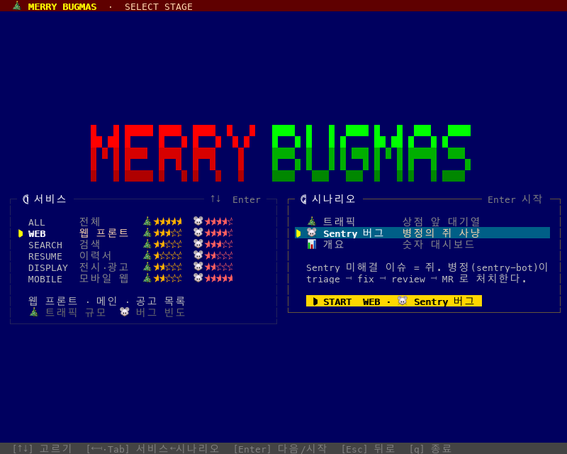
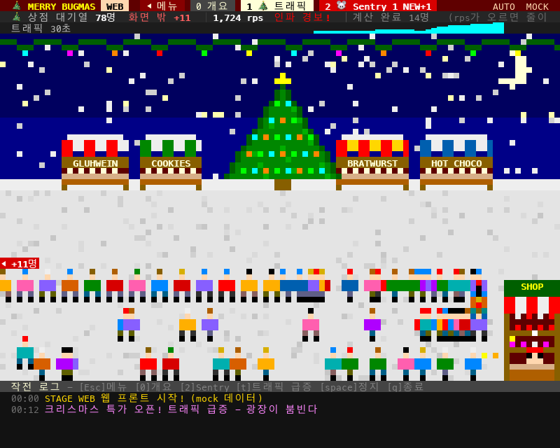
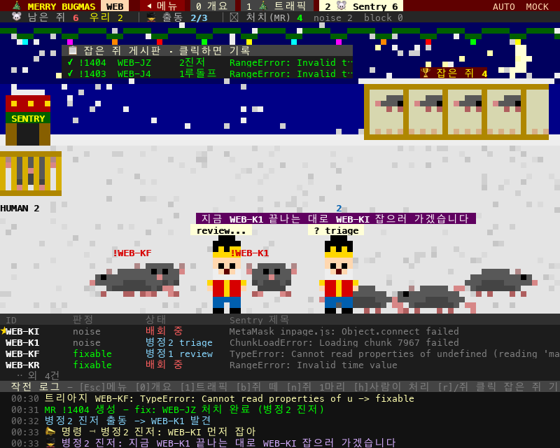
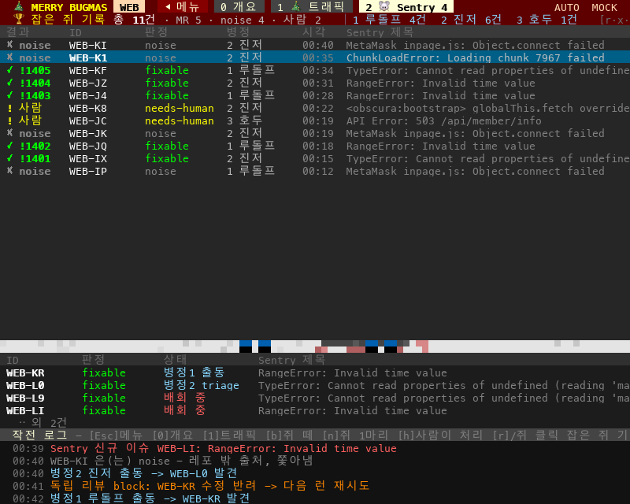
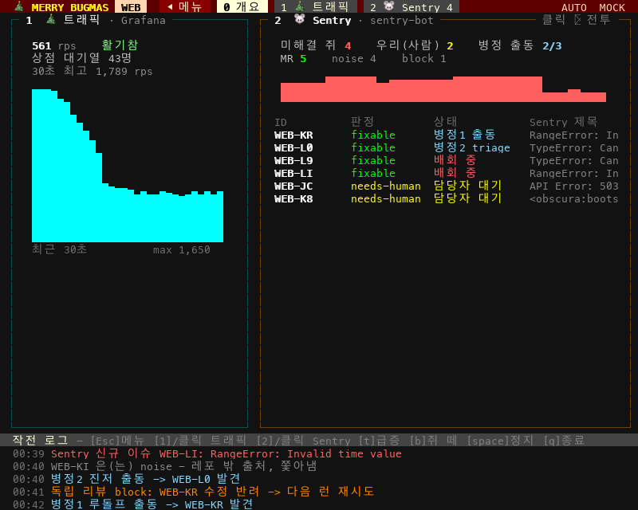
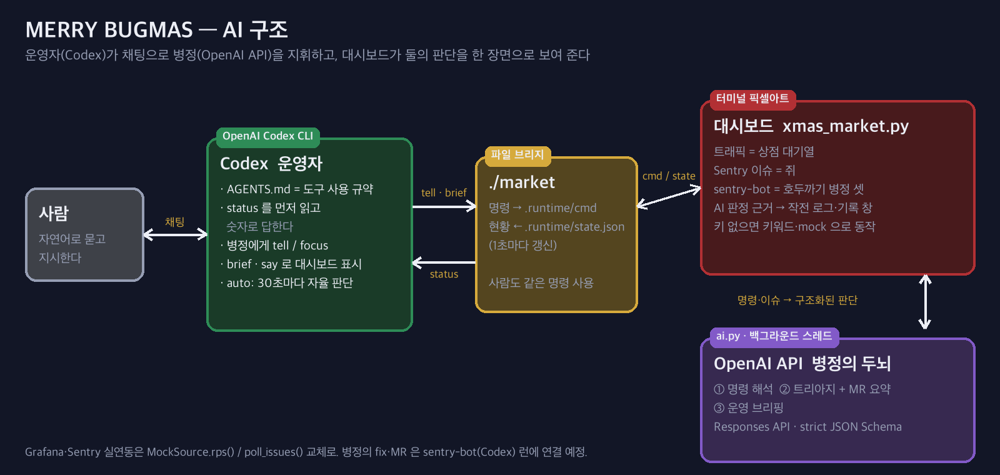
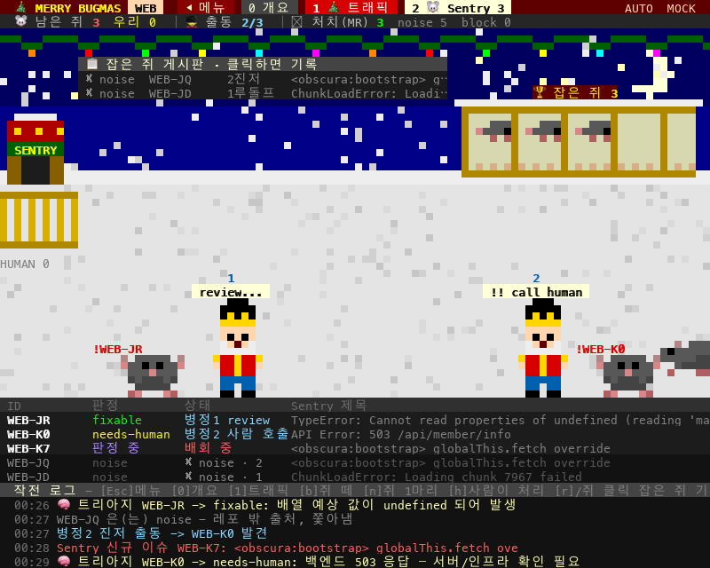
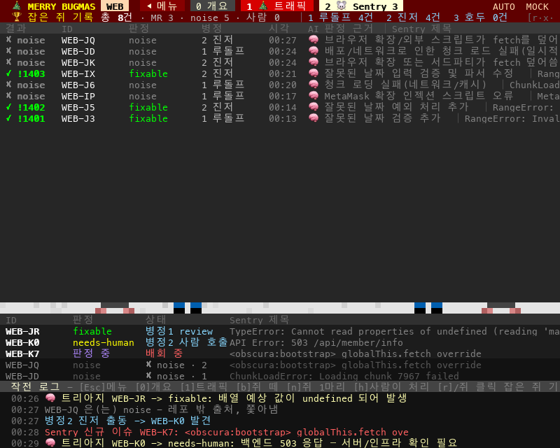

# 🎄 MERRY BUGMAS — Ops Christmas Market


운영 지표를 **크리스마스 마켓 게임**으로 보는 터미널 대시보드.
트래픽은 상점 앞에 선 손님 줄로, Sentry 미해결 이슈는 쥐로, sentry-bot 에이전트는 쥐를 잡는 호두까기 병정으로 그린다.
화면은 전부 반블록 문자 `▀` 로 그린 픽셀아트다. **기본은 mock 데이터 PoC** 이고, `--live` 로 Sentry 미해결 이슈를 실제로 읽어 올 수 있다(읽기 전용).

```bash
python3 xmas_market.py          # 대시보드 (60x22 이상, 256색, 의존성 없음, API 키 없이도 동작)
export OPENAI_API_KEY=...       # (선택, .env 에 적어도 됨) 병정이 OpenAI API 로 명령을 해석하고 이슈를 판정한다
python3 xmas_market.py --replay # 키 없이: 녹화해 둔 실제 AI 트리아지 결과로 재생
python3 xmas_market.py --live   # (선택) 쥐 = 실제 Sentry 미해결 이슈. .env 에 SENTRY_* 필요, 읽기 전용
./run-with-codex.sh             # 왼쪽 Codex 채팅 + 오른쪽 대시보드 (tmux 분할, 없으면 Terminal 창 2개)
./run-with-codex.sh auto        # 왼쪽 Codex 자율 운영자: 사람 없이 Codex 가 30초마다 판단해 병정을 지휘
```

## 왜 만들었나
장애가 나면 운영자는 Grafana(트래픽)·Sentry(에러)·자동 수정 봇(sentry-bot)의 진행 상황을 각각 다른 화면에서 맞춰 봐야 한다.
"지금 무엇이 터졌고, 봇은 무엇을 처리 중이며, 사람이 봐야 할 건 무엇인가"를 한눈에 보기 어렵고, 봇이 무슨 판단을 했는지는 더 안 보인다.

MERRY BUGMAS 는 이 셋을 **한 장면**으로 합친다. 트래픽은 줄, 에러는 쥐, 봇은 병정이라 숫자를 읽지 않아도 상황이 보이고,
병정(에이전트)이 왜 그렇게 판정했는지가 말풍선·기록으로 남는다. 그리고 운영자는 **채팅으로 에이전트를 지휘**한다.

## 30초 체험 (키·로그인 없이)
1. `python3 xmas_market.py --replay` → 아무 키 → 메뉴에서 `WEB` · `🐭 Sentry 버그` · `▶ START`
   (`--replay` 는 녹화해 둔 실제 AI 판정을 키 없이 보여 준다. 빼면 AI 없는 키워드·mock 모드다)
2. `b` 를 눌러 쥐 떼(배포 직후 신규 이슈 5건)를 풀면 병정이 출동해 triage → fix → review → MR 로 처리한다
3. `r` 로 잡은 쥐 기록, `1` 로 트래픽 대기열, `0` 으로 개요. 다른 터미널에서 `./market tell 진저 보고`

| 운영 지표 | 마켓 장면 |
|---|---|
| 트래픽 rps (Grafana 자리) | 상점 앞 대기열. 한산함 → 활기참 → 북적북적 → 인파 경보 |
| Sentry 미해결 이슈 | 호두까기 인형의 쥐 (머리 위 라벨이 이슈 ID) |
| sentry-bot 서브 에이전트 | 호두까기 병정 셋 — `1 루돌프` · `2 진저` · `3 호두`. 채팅 명령을 알아듣는다 |

## 게임처럼 진행한다

### 1. 타이틀
눈발이 점점 굵어지다가 가운데가 걷히며 `MERRY BUGMAS` 가 나온다. 아래 눈밭에서는 병정이 쥐를 쫓는다. 아무 키나 누르면 메뉴로.

### 2. 스테이지 고르기


① **서비스**(ALL · WEB · SEARCH · RESUME · DISPLAY · MOBILE)를 고르고 ② **시나리오**(🎄 트래픽 / 🐭 Sentry 버그 / 📊 개요)를 고른 뒤 `▶ START`.
서비스마다 트래픽 규모(🎄)와 버그 빈도(🐭)가 다르다. `↑↓` 고르기 · `←→`/`Tab` 열 전환 · `Enter` 다음·시작 · `Esc` 뒤로. 마우스 클릭도 된다.

### 3-1. 🎄 트래픽 — 상점 앞 대기열


손님이 오른쪽 `SHOP` 앞에 한 줄로 선다. 맨 앞 손님이 카운터에서 계산하면(동전이 튄다) 가게 안으로 들어간다.
**rps 가 오르면 줄이 길어진다.** 길면 뱀처럼 접혀 올라가고, 넘치면 왼쪽 화면 밖으로 밀려 `◀ +N명` 이 뜨며 인파 경보.
위 그림은 12초에 오는 "크리스마스 특가 오픈" 급증으로 줄이 세 줄까지 늘어난 장면이다.

### 3-2. 🐭 Sentry 버그 — 병정의 쥐 사냥


쥐(미해결 이슈)가 나오면 왼쪽 `SENTRY` 위병소에서 병정이 출동한다. 처리 방식은 sentry-bot 판정 그대로다.

- **fixable** — 칼싸움(fix) → review → `MR !14xx` 생성. 처치한 쥐는 포물선을 그리며 **뒤쪽 `🏆 잡은 쥐` 우리**로 날아간다
- **noise** — "shoo!" 하고 쫓아낸다 (레포 밖 출처)
- **needs-human** — 왼쪽 `HUMAN` 우리에 가두고 담당자 호출
- **review block**(약 15%) — 수정 반려. 쥐가 다시 풀려나 다음 런에 재시도
- 쌓인 쥐가 많으면 병정이 2·3번까지 추가 출동한다

하늘의 **`📋 잡은 쥐 게시판`** 에는 잡은 쥐가 각각 무슨 버그였는지(결과 · 이슈 ID · 병정 · Sentry 제목) 붙는다.
화면이 작아 하늘이 좁으면 아래 이슈 목록의 남는 줄에 나온다.

### 3-3. 잡은 쥐 기록


병정이 붙잡은 쥐, 게시판 줄, 뒤쪽 우리를 클릭하면(또는 `r`) 지금까지 처리한 Sentry 이슈가 모두 나온다.
결과(`✔ !MR번호` / `✖ noise` / `! 사람`) · 이슈 ID · 판정 · 맡은 병정 · 시각 · 제목. 클릭한 쥐의 줄이 강조되고, 맨 위에 병정별 처리 건수가 있다.

### 3-4. 📊 개요


움직이는 장면 없이 숫자·그래프·목록만 1초에 한 번 갱신한다. 이상이 있으면 카드 테두리가 빨개지고, 카드를 클릭하면 그 장면으로 들어간다.

## 병정에게 명령하기
병정은 각자 Sentry 쥐를 맡는 sentry-bot 서브 에이전트다. 채팅(Claude Code · Codex)에서 병정에게 말하면
`./market tell <병정> <문장>` 으로 전달되고, 병정이 문장을 알아듣고 말풍선으로 대답한 뒤 움직인다 (위 Sentry 그림의 보라색 말풍선).

```bash
./market tell 진저 WEB-2B1 먼저 잡아       # 💂 병정2 진저: 알겠습니다! WEB-2B1 잡으러 갑니다
./market tell 3 WEB-2B1 noise로 처리       # 판정을 바꿔 쫓아낸다 (사람에게 → 우리에 가두고 담당자 호출)
./market tell 1 복귀                       # 지금 건만 마치고 위병소에서 대기 / 출동 으로 재개
./market tell 모두 보고                    # 각자 지금 하는 일과 처리 건수
```

병정은 `1`·`2`·`3`, `병정2`, 이름, `모두` 로 부른다. 이름 없이 쥐를 지목하면 놀고 있는 병정 하나가 맡는다.
`OPENAI_API_KEY` 가 없으면 키워드로 알아듣는다. 있으면 아래처럼 OpenAI API 가 해석한다.

## AI 구조 — 운영자(Codex)가 병정(OpenAI API)을 지휘한다



| 층 | 누가 | 하는 일 |
|---|---|---|
| 운영자 | **Codex** (`codex` / `codex exec`) | `AGENTS.md` 를 도구 사용 규약으로 읽는다. 먼저 `./market status` 로 숫자를 확인하고 답한 뒤, 병정에게 명령하고 대시보드에 요약을 띄운다. `auto` 모드에선 사람 없이 30초마다 스스로 판단한다 |
| 병정의 두뇌 | **OpenAI API** (`ai.py`) | ① **명령 해석**: "진저한테 503 에러 난 쥐부터 처리하라고 해" → `{병정 2, catch, MOBILE-2C1}`. 키워드에 없는 말·묘사로 가리킨 쥐도 현황 JSON 에서 찾는다. 잡담엔 병정 말투로 대답 ② **트리아지**: 이슈 제목을 보고 fixable / noise / needs-human 판정 + 근거 + MR 수정 요약 ③ **브리핑**: `./market brief` → 현황 3줄 + 권고 1줄 |
| 시각화 | 대시보드 | AI 의 판정 근거가 작전 로그(🧠)·잡은 쥐 기록에 남는다. 판정을 기다리는 쥐는 `판정 중` 으로 보인다 |




위 두 화면은 실제 OpenAI API(gpt-5-mini) 호출로 찍었다 (`python3 tools/screenshots.py --ai-only`).

- 출력은 JSON Schema(strict)로 받아 그대로 게임 동작에 연결한다. 호출은 백그라운드 스레드라 화면이 멈추지 않는다.
- 키가 없거나 호출이 실패하면 키워드 해석·mock 판정으로 돌아간다 (작전 로그에 "키워드로 처리"). `--no-ai` 로 끌 수도 있다.
- 환경변수(레포의 `.env` 도 읽는다, git 제외): `OPENAI_API_KEY`, `XMAS_AI_MODEL`(기본 `gpt-5-mini`), `XMAS_AI_EFFORT`(기본 `low`), `XMAS_AI=off`, `XMAS_AI_RECORD=경로`(트리아지 녹화).
- **녹화 재생** `--replay`: `recordings/ai.jsonl` 에 녹화해 둔 실제 OpenAI 트리아지 결과를 같은 이슈 제목에 다시 쓴다. 키 없이 AI 판정 화면을 볼 수 있다. 녹화에 없는 이슈와 명령 해석·브리핑은 키워드·mock 으로 처리하며, 응답을 새로 지어내지 않는다.

### AI 트리아지 평가
**결과 (gpt-5-mini, 2026-11-27): 정확도 29/32 = 90.6%, 평균 응답 4.2초, 호출 실패 0건** — [전체 결과·혼동 행렬](docs/eval/triage-gpt-5-mini.md).
needs-human 8건은 모두 맞혔다. 틀린 3건 중 2건은 사람에게 넘기는 보수적 오판이고, 1건(fixable → noise)은 실제 버그를 놓치는 방향이다: `sessionStorage access denied`(fixable → noise), JSON 자리에 HTML 이 온 파싱 오류(fixable → needs-human, 서버 응답 문제로 봄), `Object Not Found Matching Id`(noise → needs-human).

`python3 tools/eval_triage.py --record recordings/ai.jsonl` 은 정답이 달린 Sentry 이슈 제목 32건(`tests/data/triage_eval.jsonl`: fixable 14 · noise 10 · needs-human 8)을 판정한다. 정확도·혼동 행렬·응답 시간을 `docs/eval/` 에 남기고, 같은 결과를 녹화 재생용으로도 쓴다.

**한계**: 평가셋은 직접 만든 32건(제목만, 1회 실행)이고 그중 11건은 데모 카탈로그와 같은 제목이다. 프롬프트의 예시와 유형이 겹치므로 실제 이슈에서는 더 낮을 수 있다. 명령 해석·브리핑은 정량 평가를 하지 않았다.

- `AGENTS.md` 는 채팅 에이전트용 운영 규약이다. 어떤 명령이 있고, 답하기 전에 무엇을 읽고, 무엇을 고치면 안 되는지를 Codex 가 따르도록 적어 두었다.

## 채팅 ↔ 대시보드
Codex·Claude Code 는 이 폴더에서 `AGENTS.md` 를 읽고, 대시보드와는 `.runtime/` 파일로 이어진다.
- 대시보드는 1초마다 `.runtime/state.json` 에 현황(단계·서비스·트래픽·쥐·병정·잡은 쥐 기록·로그)을 쓴다. 채팅은 `./market status` 로 읽고 숫자로 답한다.
- 채팅이 `./market start WEB sentry`, `./market tell …`, `./market say …`, `./market outbreak 3` 등을 실행하면 `.runtime/cmd` 를 거쳐 바로 반영된다.
- 사람도 같은 명령을 쓸 수 있다. 목록은 `./market help`. `./market brief` 는 AI 운영 브리핑.
- Claude Code 옆 패널에 띄울 때는 `python3 xmas_market.py --stream --size 90x40` 이 프레임을 JSON 줄로 내보내고, `.runtime/pane_cmd` 로 키·클릭을 받는다.

## 키

| 키 | 동작 |
|---|---|
| `↑↓` `←→` `Tab` `Enter` | 메뉴에서 고르기·시작 |
| `Esc` `m` | 메뉴로 |
| `0` `1` `2` / 탭 클릭 | 개요 / 트래픽 / Sentry |
| `t` | 트래픽 급증 |
| `b` · `n` | 쥐 떼(5마리) · 쥐 1마리 |
| `h` | 담당자가 우리 속 쥐 처리 |
| `r` | 잡은 쥐 기록 열기/닫기 |
| `a` | 자동 연출 on/off |
| `space` · `q` | 일시정지 · 종료 |

자동 연출은 90초 주기로 돈다. 12초에 특가 오픈으로 트래픽이 급증하고, 45초에 배포 직후 쥐 떼가 나온다.

터미널 설정에서 "애매한 폭 문자를 2칸으로" 옵션이 켜져 있으면 화면이 깨지니 끈다 (macOS 기본값은 꺼짐).

```bash
python3 xmas_market.py --skip-intro                                  # 타이틀 없이 메뉴부터
python3 xmas_market.py --snapshot 50 --size 100x30 --view sentry --service WEB [--plain]   # 한 프레임 미리보기
python3 tools/screenshots.py                                         # README 이미지 다시 만들기 (Pillow 필요)
python3 tools/diagram.py                                             # AI 구조도 다시 그리기 (Pillow 필요)
python3 -m unittest discover -s tests -v                             # 스모크 테스트 (네트워크·키 없이)
```

## 테스트
`tests/test_smoke.py` (표준 라이브러리 unittest, 26개, 1.5초):
- 6개 서비스 × 3개 화면(18개 조합) + 타이틀·메뉴·기록 창이 오류 없이 그려지는지
- 키워드 병정 명령 (지목·복귀·보고)
- AI 병정을 가짜 OpenAI 응답으로: 묘사로 가리킨 쥐 해석, 트리아지가 mock 판정을 바꾸고 MR 로그에 수정 요약이 붙는지, 브리핑, 요청이 strict JSON Schema 인지, **API 실패 시 키워드로 폴백**하는지
- 경합·이상 응답: 사람이 내린 판정을 늦게 온 AI 판정이 덮지 않는지, AI 판정이 8초 안에 안 오면 mock 판정으로 넘어가는지, 스키마를 벗어난 응답·429 재시도·판이 바뀐 뒤 도착한 결과
- 녹화·재생: 녹화한 트리아지 결과가 `--replay` 에서 그대로 나오는지
- Sentry 실연동을 가짜 Sentry 응답으로: 실제 이슈가 중복 없이 쥐가 되는지, 가짜 쥐가 섞이지 않는지, AI 가 실제 제목을 판정하는지, **읽기 실패 시 mock 으로 폴백**하는지

권장 환경: macOS / Linux, 256색 터미널 100x30 이상. macOS · Python 3.9 에서 실행을 확인했고, Linux · Python 3.8 은 문법 호환만 확인했다. Windows 는 WSL 에서 실행한다 (`termios` 사용).

## Sentry 실연동 (읽기 전용)
`--live` 로 띄우면 쥐가 mock 이 아니라 **실제 Sentry 프로젝트의 미해결 이슈**다 (`sentry_live.py`, 표준 라이브러리만).

```bash
python3 xmas_market.py --live            # 화면 오른쪽 위 배지가 MOCK → LIVE SENTRY
python3 xmas_market.py --live --no-ai    # OpenAI 호출 없이 키워드 판정
```

- `.env`: `SENTRY_AUTH_TOKEN`(권한은 event:read 만) · `SENTRY_ORG` · `SENTRY_PROJECT`. 선택: `SENTRY_URL`(기본 `https://sentry.io`) · `SENTRY_LIMIT`(기본 20) · `SENTRY_POLL`(초, 기본 15)
- 15초마다 미해결 이슈를 읽어 처음 본 것만 쥐로 만든다. AI 가 켜져 있으면 그 **실제 제목**을 OpenAI API 가 판정한다
- Sentry 에는 아무것도 쓰지 않는다. 병정의 판정·fix·MR 은 대시보드 안의 연출이고 Sentry 이슈 상태는 그대로다
- 실연동 중에는 `b`·`n`·자동 쥐 떼가 가짜 쥐를 만들지 않는다. 설정이 없거나 첫 읽기가 실패하면 원인을 로그에 남기고 mock 으로 돈다
- 트래픽(rps)은 여전히 mock 이다

**검증 범위 (2026-11-27)**: 테스트용 Sentry 프로젝트로 확인했다. 실제 서비스의 이슈가 아니다.
- 데모 웹앱 [merrybugmas/demo-web](https://github.com/merrybugmas/demo-web): 일부러 버그를 심어 둔 상점 페이지. 버튼을 누르면 진짜 브라우저 에러 7종이 Sentry 브라우저 SDK 를 거쳐 이슈가 되고, 대시보드가 그것을 읽어 쥐로 만드는 것까지 확인했다
- `python3 tools/sentry_seed.py`: 평가셋 제목으로 테스트 이벤트를 직접 넣는 스크립트(`SENTRY_DSN` 필요). 12건을 보내 11건이 이슈가 됐다

## 더 연동할 때
- 트래픽: `MockSource.rps(t)` 를 Grafana(또는 Prometheus) 쿼리 결과로 바꾼다 (아직 안 했다)
- 트리아지 입력을 이슈 제목에서 스택트레이스·관련 소스까지 넓힌다
- 병정의 fix·review·MR 은 아직 연출이다. 실연동에서는 병정 하나를 sentry-bot(Codex) 런 하나에 붙여 런 로그와 state 로 움직이게 하고 `tell` 명령을 런에 넘긴다

## 라이선스
MIT — [LICENSE](LICENSE)
