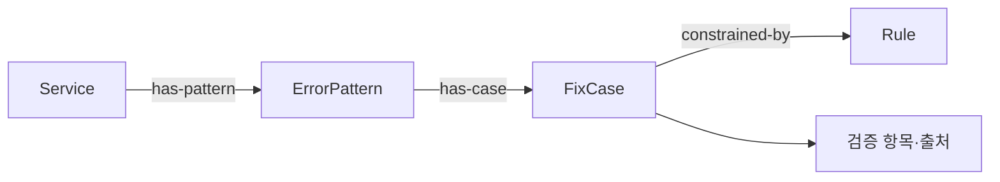

# 작전 교본 — 가벼운 온톨로지 + 사례 검색 RAG

병정은 Sentry 이슈와 관련된 서비스 규칙/수정 사례를 검색해 분류·패치·Codex 리뷰에 함께 사용한다.
검색 이유, 출처, 지식 버전을 대시보드와 PR에 남긴다. 모델 가중치를 학습시키는 기능은 아니다.

## 바로 시연하기 (OpenAI 0회)

```bash
python3 knowledge.py validate
python3 tools/demo_knowledge.py
python3 tools/demo_knowledge.py --no-knowledge
python3 tools/eval_knowledge.py --output .runtime/knowledge-eval.json
```

데모는 동일한 쿠폰 오류에 대해 KB ON이면 CASE-001·적용 규칙·검색 이유·출처를 보여 준다.
데이터는 명시적인 데모이며, 모델 응답이나 실제 PR을 만들어 내지 않는다.
화면의 `검색 참고 자료`와 `AI 분류에 전달`을 구분한다. `--replay`도 새 지식으로 재분류한 것으로 표시하지 않는다.

대시보드에서는 이슈를 클릭하거나 아래 명령으로 참고 지식을 볼 수 있다.

```bash
python3 xmas_market.py --skip-intro
./market start WEB sentry
./market outbreak 5
./market kb                 # 참고 사례가 있는 첫 이슈
./market kb WEB-xxx          # 지정한 실제 표시 ID
./market status             # mice/history[].knowledge, knowledge_usage
```

## 실연동

기존 Sentry/OpenAI/대상 레포 설정에 다음을 더한다. 예시는 데모 프로젝트 기준이다.

```bash
export XMAS_FIX_REPO=/absolute/path/to/demo-web
export XMAS_KB_REPO=merrybugmas/demo-web
export SENTRY_EVENT_CONTEXT=on
python3 xmas_market.py --live
```

- `XMAS_KB_REPO`: 대상 레포의 `owner/repo`. 없으면 XMAS_FIX_REPO의 GitHub origin에서 한 번 읽는다. 폴더 이름으로 추측하지 않는다.
- `knowledge/services.json`: Sentry 프로젝트 slug → 서비스 연결. 실연동은 화면에서 선택한 서비스로 지식을 고르지 않는다. 매핑이 없으면 참고 사례 없이 진행한다.
- `XMAS_KB_DIR` 또는 `--knowledge DIR`: 교본 디렉터리. 기본은 이 레포의 `knowledge/`.
- `XMAS_KB=off` 또는 `--no-knowledge`: 사례 검색을 끈다. 기존 BUSINESS_RULES.md 문의/주의 규칙은 그대로 적용된다.
- `SENTRY_EVENT_CONTEXT=on`: 처음 본 이슈당 대표 이벤트를 한 번 읽는다. 기본 off. 기존 event:read 권한을 사용한다. 예외 유형·파일/함수·줄·release·environment만 전달하고 사용자/요청 본문/locals를 복사하지 않는다. 상세 조회가 실패해도 이슈 수집은 계속된다.

Sentry API: [Retrieve an Issue Event](https://docs.sentry.io/api/events/retrieve-an-issue-event/).

## 온톨로지와 검색



| 파일 | 내용 |
|---|---|
| services.json | id, repo, service, projects(Sentry slug 목록) |
| patterns.json | id, keywords, functions, files, error_types, exclude |
| rules.json | id, text(정상 동작/제약) |
| cases/*.json | id, service_id, pattern_id, rule_ids, kind, status, 조건/회피 조건/수정 방향/테스트/출처 |

시작 시 파일을 읽고 ID 중복·관계 참조·상태를 검증한다. 오류가 있으면 corpus 전체를 비활성화하고 로그를 남긴다.
이슈 검색은 메모리에 적재된 자료만 사용한다. 추가 라이브러리·검색 서버·임베딩·OpenAI 호출이 없다.

1. 레포와 서비스를 정확히 일치시킨다.
2. candidate/rejected/deprecated 상태와 제외 조건에 맞는 사례를 제외한다.
3. 증상 키워드(최대 12점), 함수(6점), 오류 유형(2점), 파일(1점)을 합산한다.
4. 증상/함수 일치가 없는 `TypeError`·`app.js` 단독 일치는 반환하지 않는다.
5. 점수순, 동점이면 ID순으로 최대 3건을 선택하고 연결된 규칙을 붙인다.

이유와 관계는 코드가 계산한다. 모델에게 출처나 사례 ID를 새로 만들어 달라고 하지 않는다.
검색은 진단을 확정하지 않으며, 프롬프트는 현재 이벤트/코드와 적용 조건을 다시 대조하게 한다.
지식은 참고 데이터로 전달하고 BUSINESS_RULES.md의 `문의` 조건이나 사람의 판정을 덮지 않는다.

선택한 snapshot은 이슈에 보관한다. 분류·수정·리뷰·처리 기록·PR이 같은 지식 버전과 사례를 참조한다.
현재 패치 검증은 기존 문법 검사·Codex 리뷰를 사용하며, 사례의 회귀 테스트 항목은 PR 체크리스트로 제공한다.

## 초기 10건과 검증 상태

쿠폰 null·items 누락·잘못된 배송일·HTML/JSON·회원 503·결제 500·외부 광고·저장소 접근 거부·청크 로딩·toSorted 사례다.
모두 **reference**: 데모 코드/평가 fixture에서 정리한 참고 자료다. 실제 해결 성공 사례가 아니다.
데모 코드 출처의 blob SHA를 기록했으며 현재 코드가 바뀌면 적용 조건을 다시 검토해야 한다.
레포/서비스 매핑이 맞는 사례만 검색된다. 새 서비스를 붙일 때 해당 서비스의 실제 규칙과 사례를 작성한다.
청크 실패 사례는 release/자산 오류 확인을 요구하므로, 기존 제목만 평가셋의 일괄 noise 정답과는 정책이 다르다.

| 상태 | 의미 | 검색 |
|---|---|---|
| reference | 출처가 있는 참고 패턴. 해결 검증 안 됨 | 포함 |
| reviewed | 사람이 적용 조건/수정 방향을 검토 | 포함 |
| verified | 테스트·머지·배포/관측 등 해결 근거를 verification에 기록 | 포함 |
| candidate | 실행 중 생성된 미검증 초안 | 제외 |
| rejected / deprecated | 반려되거나 더 이상 적용할 수 없음 | 제외 |

실제 수정 worker는 성공/반려/실패를 `.runtime/knowledge_candidates/*.json`에 원자적으로 기록한다.
내용: 대상 이슈, 참고 지식 버전/출처, 수정 전 파일 해시, 제안 diff/설명, 리뷰 결과, PR 주소.
PR 생성은 `pr-open`이며 merged/deployed/resolved는 false다. 후보는 자동으로 검색 corpus에 합치지 않는다.
검토자가 후보의 원인·조건·증거를 확인하고 cases/*.json 형식으로 정리한 다음 PR로 반영한다.
원시 이벤트 전체는 저장하지 않지만 후보에는 이슈 제목과 코드 diff가 있으므로 `.runtime/`은 Git에 넣지 않는다.

## 변경 지점과 검증

- xmas_market: 적재/검색 snapshot, 서비스 범위, status/history와 `kb` 명령.
- ai.Brain.triage: 이벤트 맥락 + 검색 지식을 기존 요청에 추가. 녹화에 지식 출처도 기록.
- fixer.Fixer: 동일 snapshot을 패치/리뷰에 전달, PR에 근거/체크리스트, 결과 후보 저장.
- sentry_live: 원본 Sentry ID/project 보존, 선택적 대표 이벤트 조회.

```bash
python3 -m unittest discover -s tests -v
python3 tools/eval_knowledge.py
# 실제 모델의 같은 입력·같은 모델 KB OFF/ON 비교 (사례당 2회 요청, 재시도 가능)
python3 tools/eval_knowledge.py --live --data /path/to/separate-evaluation.jsonl --output .runtime/kb-live.json
```

기본 평가는 검색 회귀 fixture 10건이며 모델 정확도/수정 성공률 평가가 아니다.
별도 평가셋은 id/repo/service/title/culprit/expected(사례 ID 또는 null)/kind 필드를 갖는 JSONL이다.
실제 비교는 분류 정답, false-noise, 호출 실패, 응답 시간을 기록한다. 초기 교본 작성에 쓰지 않은 이슈를 별도로 준비한다.
