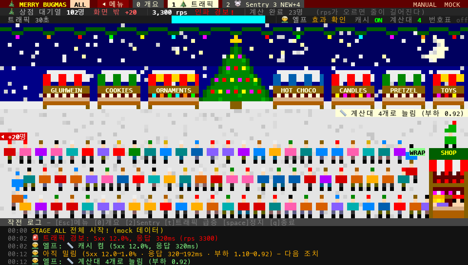

# 🧝 엘프 — 트래픽 대응 에이전트

> 요약: 트래픽이 몰려 서버가 밀리면, 상점 지붕 위의 **엘프 점원**이 감지 → 판단(규칙 또는 OpenAI) → 레버 → 효과 확인 → 원복까지 스스로 한다.
> Sentry 쪽 병정(sentry-bot)이 쥐를 처리하는 것과 같은 틀의 **두 번째 에이전트**다. 위험한 레버(번호표)는 사람 승인 없이 당기지 않는다.



## 1. 한눈에

| 항목 | 내용 |
|---|---|
| 코드 | `elf.py` (판단·상태 기계), `xmas_market.py` (그리기·명령 연결), `traffic_live.py` (`LeverClient`, 레버 게이지 읽기), `ai.py` (`traffic` 작업) |
| 데모 서버 | [merrybugmas/demo-web](https://github.com/merrybugmas/demo-web) `server.py` — 처리 슬롯 제한 + `/admin/levers` |
| 테스트 | `tests/test_elf.py` (17개, 네트워크·OpenAI 없이) |
| 채팅 | `./market tell 엘프 <말>` · `./market elf <말>` (OpenAI 안 씀) |
| 현황 | `./market status` → `traffic.elf` |

## 2. 동작 흐름

```
idle(감시) ──경보 2초 이상──▶ 판단 ──▶ 레버 당김 ──▶ watch(10초 지켜봄) ──▶ 숫자 비교
   ▲                          │                                        │
   │                 AI 면 think(최대 12초)                    아직 밀림 → 다음 레버
   │                          │                                        │
   │              번호표면 ask(사람 승인 대기, 60초 넘으면 담당자 호출)   해소 → ✅ idle
   │
   └── 15초 잠잠하면 번호표 → 계산대 → 캐시 순으로 5초 간격 원복 (🧹)
```

- **경보 조건**
  - 실서버: 5xx ≥ 5% **또는** 평균 응답 ≥ 300ms **또는** 슬롯 대기 요청 ≥ 계산대 × 2
  - mock: 부하 ≥ 0.9 (부하 = rps ÷ (최고치 × 계산대/2 × 캐시 1.2))
- **잠잠 조건**: 5xx < 1%, 응답 < 150ms, rps < 최고치의 60%
- **API 장애 구분**: 부하는 낮은데(응답 < 150ms, 대기 0) 5xx 만 높으면 레버로 못 고치는 문제로 보고 바로 담당자를 부른다

## 3. 레버

| 레버 | demo-web 에서 하는 일 | 화면 | 누가 |
|---|---|---|---|
| 🎁 `cache` | `/api/gifts` 응답 캐시 (80~160ms → 3ms) | 간판 옆 `WRAP` 팻말 | 엘프 자동 |
| 🧾 `capacity` | 동시 처리 슬롯 +2 (기본 2, 최대 8) | 가게 안 산타 점원 수 | 엘프 자동 |
| 🎫 `waitroom` | 번호표: 자리가 0.15초 안에 안 나면 기다리게 두지 않고 429 | `TICKET` 팻말, 줄이 화면 밖으로 안 넘침 | **사람 승인 후** |
| 📞 `human` | 레버로 안 되는 문제 → 담당자 호출 | 말풍선 | 엘프 자동 |

규칙 순서(AI 가 없거나 실패·지연·예산 소진일 때): API 장애면 `human` → `cache` → `capacity`(최대까지) → `waitroom`(승인) → `human`.

### demo-web 서버 쪽 (실제로 밀리고, 실제로 풀린다)
- `/api/*` 는 동시에 `capacity`개(기본 2, `DEMO_CAPACITY`)까지만 처리한다. 자리를 1초 못 얻으면 503 `overloaded`. `/api/ping` 도 20ms 걸린다 → 약 65 rps 가 한계
- `GET`/`POST /admin/levers` (127.0.0.1 에서만): `{"cache": true}` · `{"capacity": 4}` · `{"waitroom": true}`
- `/metrics` 에 `demo_capacity` · `demo_inflight` · `demo_waiting` · `demo_cache_enabled` · `demo_waitroom_enabled` · `demo_rejected_total{reason}`

측정 (110 rps 급증, 5초씩):

| 레버 | 5xx | 429 | 평균 응답 |
|---|---|---|---|
| 없음 (슬롯 2) | 15.4% | 0% | 769ms |
| 캐시 | 0% | 0% | 46ms |
| 캐시 + 슬롯 4 | 0% | 0% | 25ms |
| 번호표만 | 0% | 35% | 150ms |

엘프 자동 대응 전체 (25 → 110 → 25 rps, AI 끄고 규칙): 6초 경보 → 캐시 → 16초 계산대 4 → 26초 해소(5xx 16.9→0.1%, 응답 994→76ms) → 급증 끝나고 계산대·캐시 원복.

## 4. AI 판단 (OpenAI, 크레딧 보호)

- 경보마다 **첫 판단만** OpenAI 에 묻는다. 같은 경보의 다음 판단은 규칙이다
- 요청 1번 = HTTP 1번 (재시도 없음). 보내는 것: `load · rps · peak_rps · error_pct · latency_ms · waiting · api_errors · levers · tried · max_capacity · source`
- 응답 스키마 `traffic_lever`: `{"lever": cache|capacity|waitroom|human|none, "reason": "...", "say": "..."}`
- 한 번 실행에 `XMAS_AI_TRAFFIC_MAX`(기본 5)회까지. 판(서비스)을 바꿔도 이어서 센다. 다 쓰면 로그에 "AI 예산 다 씀" 후 규칙으로
- AI 가 이미 쓴 레버를 고르거나, 실패하거나, 12초 안에 답이 없으면 규칙으로
- `--replay`(녹화 재생)·`--no-ai`·키 없음이면 묻지 않는다
- 엘프에게 하는 채팅 명령은 키워드로만 처리한다 (OpenAI 0회)

## 5. 채팅 명령 (`./market tell 엘프 <말>`)

| 말 | 동작 |
|---|---|
| `캐시 켜` / `캐시 꺼` | 캐시 레버 |
| `계산대 6` · `계산대 늘려` · `계산대 줄여` | 슬롯 수 지정 / ±2 (1~8) |
| `번호표 켜` / `번호표 꺼` | 사람이 직접 시킨 것이라 승인 불필요 |
| `승인` (또는 `ok`·`좋아` 한 단어) / `거절` | 엘프가 물어본 번호표 승인·거절. "보고해줘" 같은 말로는 승인되지 않는다 |
| `원복` | 모든 레버를 처음 값으로 |
| `보고` | 상태·레버·5xx·응답·조치 건수를 말풍선으로 |
| `자동 꺼` / `자동 켜` | 자동 대응 멈춤·재개 (멈추면 승인 대기도 취소) |

## 6. `./market status` 의 `traffic.elf`

```json
{
  "state": "watch",              // idle 감시 / think AI 판단 / ask 승인 대기 / watch 효과 확인 / flag 담당자 호출 / cool / off
  "auto": true,
  "levers": {"cache": true, "capacity": 4, "waitroom": false},
  "base":   {"cache": false, "capacity": 2, "waitroom": false},   // 원복 기준 (실서버는 처음 읽은 값)
  "pending_approval": null,       // "waitroom" 이면 사용자에게 승인 여부를 묻는다
  "pressure": {"load": 0.92, "error_pct": 1.0, "latency_ms": 192, "waiting": 0, "alarm": true, "mock": true},
  "ai": {"used": 1, "max": 5},
  "actions": [{"t": 2.1, "lever": "cache", "by": "규칙", "reason": "5xx 12.0%, 응답 320ms", "result": "부족: ..."}]
}
```

`pressure.mock: true` 면 5xx·응답 시간은 대시보드가 부하로 **추정한 값**이다 (실측 아님). 실측은 `traffic.web`.

## 7. 안전장치

- 레버는 데모 서버(localhost)에만 있다. `--live` 인데 서버에 레버가 없으면 **바꾼 척하지 않고** 담당자 호출·알림만 한다
- 번호표(요청 거절)는 사람 승인 없이 켜지 않는다. 60초 승인이 없으면 담당자를 부른다
- 서버에 레버 변경을 보낸 직후 `/metrics` 가 아직 옛 값을 보여 줘도 덮어쓰지 않는다 (서버가 확인한 값과 같아질 때까지, 최대 5초)
- 레버 호출·AI 호출은 백그라운드 스레드에서 해서 화면이 멈추지 않는다. 실패는 로그에만 남는다

## 8. 시연 순서 (1분)

```bash
cd ~/demo-web && python3 server.py                       # 레버 있는 데모 서버
python3 loadgen.py 25 --spike 110 --at 15 --for 30        # 15초 뒤 30초 급증 (또는 페이지의 특가 오픈 버튼)
cd ~/merrybugmas && python3 xmas_market.py --live         # 또는 패널: /merrybugmas
# 메뉴 → 🎄 트래픽. 급증 → 🚨 경보 → 🧝 캐시 → 계산대 → ✅ 해소 → 🧹 원복
./market tell 엘프 보고
```

mock 으로만 볼 때: `python3 xmas_market.py --no-ai` → 🎄 트래픽 → `t`(급증). 엘프가 같은 순서로 대응한다.
