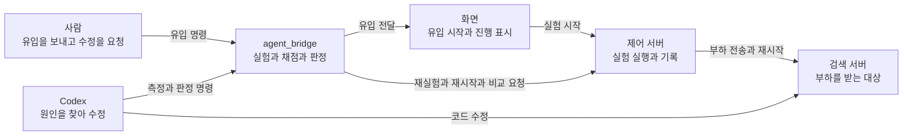
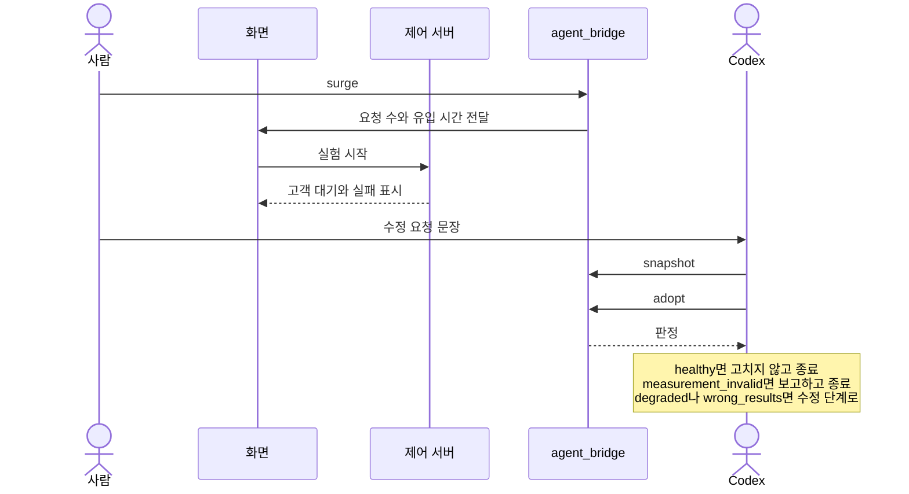
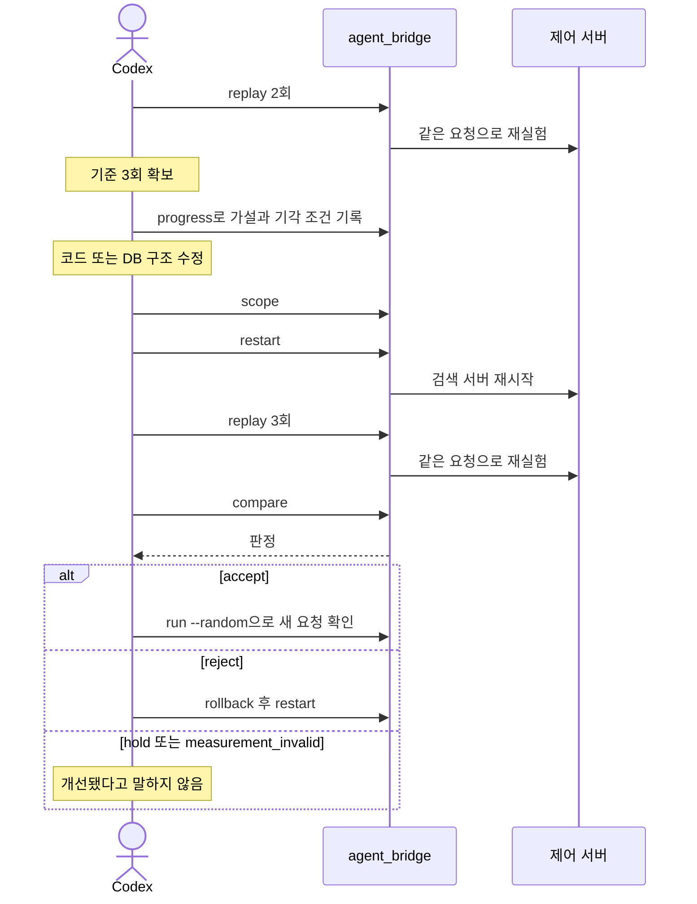
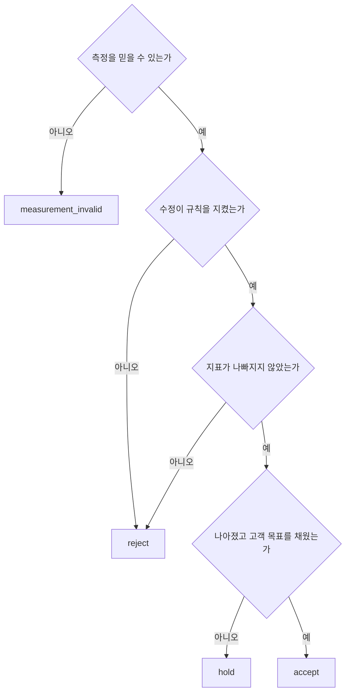

# agent_bridge

검색 서버에 부하가 몰려 문제가 생겼을 때 Codex가 원인을 찾아 고치고, 정말 나아졌는지 같은 요청으로 다시 확인하는 과정을 돕는 명령 도구다.

이 도구는 실험 실행과 기록과 판정만 한다. 원인 진단과 코드 수정은 Codex가 한다. 검색 서버와 화면은 [`../backend/`](../backend)와 [`../frontend/`](../frontend)에 있고 이 폴더는 그 코드를 바꾸지 않는다. 서버와 화면의 설명은 [상위 README](../README.md)에 있다.

## 1. 무엇을 하는가

| 기능 | 내용 |
|---|---|
| 유입 보내기 | 사람이 요청 수와 속도를 무작위로 골라 화면에 고객 급증을 보낸다 |
| 실험 넘겨받기 | Codex가 화면에서 보낸 실험을 기준 실험으로 등록한다 |
| 채점 | 예정한 검색 중 대기 한도 안에 올바른 결과를 받은 비율을 계산한다 |
| 전후 비교 | 수정 전 3회와 수정 후 3회를 비교해 `accept` `reject` `hold` `measurement_invalid` 중 하나로 판정한다 |
| 보호 | 수정 전 상태를 저장하고 되돌린다. 허용한 파일만 바뀌었는지 확인한다 |
| 출발 상태 | 시연 전에 서버를 문제 상태 두 가지와 정상 상태 한 가지 중 하나로 맞춘다 |

기술 스택은 Python 3.11 이상과 표준 라이브러리, `httpx`, SQLite, `git` 명령이다. 새로 추가한 패키지는 없다.

## 2. 시스템 구조

### 2.1 전체 구조

이 도구가 무엇과 연결되는지 보여 준다. 사람과 Codex는 `agent_bridge`에 명령을 내리고 `agent_bridge`는 화면과 제어 서버를 통해 일한다.



| 구성 요소 | 역할 | 만든 곳 |
|---|---|---|
| 사람 | 출발 상태를 고르고 유입을 보낸 뒤 Codex에게 수정을 요청한다 | |
| Codex | 실험 기록을 읽어 원인을 찾고 검색 서버 코드나 DB 구조를 고친다 | |
| agent_bridge | 명령을 받아 실험을 실행하고 채점하고 수정의 채택 여부를 판정한다 | 이 폴더 |
| 화면 | 사람이 보낸 유입을 제어 서버에 시작시키고 고객 대기와 Codex의 진행 단계를 보여 준다 | [`../frontend/`](../frontend) |
| 제어 서버 | 부하 실행기와 검색 서버를 실행하고 실험 기록을 데이터 폴더에 남긴다 | [`../backend/`](../backend) |
| 검색 서버 | 상품 검색 요청을 받는다. Codex가 고치는 대상이다 | [`../backend/`](../backend) |

그림에 넣지 않은 연결이 하나 있다. `agent_bridge`는 채점할 때 제어 서버가 데이터 폴더에 남긴 기록 파일과 상품 DB를 직접 읽는다. 검색 서버에는 요청을 보내지 않는다.

### 2.2 핵심 처리 흐름

시연 한 번은 두 단계로 나뉜다. 사람이 유입을 보내 Codex가 상태를 판단하는 단계와 Codex가 고친 뒤 검증받는 단계다.

#### 유입에서 상태 판단까지

사람이 보낸 유입 한 번을 Codex가 넘겨받아 고칠 필요가 있는지 판단한다.



1. `surge`는 요청 수와 속도를 무작위로 고른다. 유입을 실제로 시작하는 것은 화면이다.
2. `snapshot`은 수정 전의 `backend/`와 DB 구조를 저장한다.
3. `adopt`는 화면에서 보낸 가장 최근 실험을 기준 실험으로 등록하고 채점한다. Codex는 유입을 새로 보내지 않는다.

관련 코드: [`operations.py`](operations.py)의 `adopt`, [`verify.py`](verify.py)의 `report`, [`../market`](../market)

#### 수정에서 채택 판정까지

Codex가 한 가지 원인을 고친 뒤 같은 요청으로 다시 재서 판정을 받는다.



1. `replay`는 같은 요청 목록을 다시 보낸다. 수정 전후를 같은 조건으로 비교하기 위해서다.
2. `scope`는 허용한 두 파일만 바뀌었는지 확인한다. 통과하지 못하면 `restart`가 거절된다.
3. `compare`의 판정 규칙은 [4.2](#42-전후-비교의-판정)에 있다.
4. 수정 시도는 세 번까지 한다. 전체 절차는 [`../.agents/skills/performance-repair/SKILL.md`](../.agents/skills/performance-repair/SKILL.md)에 있다.

관련 코드: [`operations.py`](operations.py)의 `execute` `restart` `compare`, [`guard.py`](guard.py)의 `scope` `rollback`

### 2.3 주요 모듈과 코드 위치

| 모듈 | 역할 | 고칠 때 주의할 점 |
|---|---|---|
| [`__main__.py`](__main__.py) | 명령의 인자를 해석해 아래 모듈의 함수에 연결한다. 판단 로직은 두지 않는다 | 명령 이름과 인자는 Codex의 Skill이 쓰고 있다. 바꾸면 [`../.agents/skills/performance-repair/SKILL.md`](../.agents/skills/performance-repair/SKILL.md)를 함께 고친다 |
| [`operations.py`](operations.py) | 제어 서버 API를 호출한다. 이번 시도의 실험 묶음을 기록하고 최종 판정을 낸다 | `compare`의 조건 순서가 판정을 정한다. 순서를 바꾸면 [`../tests/test_agent_bridge.py`](../tests/test_agent_bridge.py)의 판정 테스트를 함께 본다 |
| [`verify.py`](verify.py) | 실험 한 번의 원본 기록을 읽어 고객 기준 결과와 측정 유효성을 계산한다 | 검색 서버 코드를 불러 쓰지 않는다. 불러 쓰면 Codex의 수정이 채점 기준을 바꾸게 된다 |
| [`guard.py`](guard.py) | `backend/`를 복사해 두고 되돌린다. 파일 내용 해시로 수정 범위를 확인한다 | `rollback`은 파일을 지운다. 복사본 확인이 삭제보다 먼저 실행돼야 한다 |
| [`scenario.py`](scenario.py) | 출발 상태에 맞게 결함 파일과 검색 인덱스를 넣거나 뺀다 | 코드와 DB를 바꾸기 전에 현재 상태를 확인하는 순서를 지킨다 |
| [`faults/stock_recheck.patch`](faults/stock_recheck.patch) | 출발 상태 `b`의 결함 | `backend/catalog.py`가 바뀌면 적용되지 않을 수 있다. 테스트가 적용 가능 여부를 확인한다 |
| [`limits.json`](limits.json) | 유입 범위와 고객 목표와 반복 횟수 | 범위를 넓히면 부하를 보내는 쪽이 밀려 측정 무효가 늘 수 있다 |
| [`policies.json`](policies.json) | 제어 서버의 전후 비교 정책 `demo-v1` | 제어 서버를 켤 때 `MBM_POLICIES`로 지정해야 읽힌다 |

## 3. 시작하기

### 준비

Python 3.11 이상이 필요하다. 설치는 [상위 README의 빠른 시작](../README.md)을 따른다. 아래 명령은 모두 `traffic-scenario/`에서 실행한다.

```bash
cd traffic-scenario
python3 -m venv .venv
source .venv/bin/activate
pip install -r requirements.lock
```

### 시연 준비

[`../demo`](../demo) 스크립트가 환경변수 지정과 상품 DB 생성과 출발 상태 전환과 서버 시작을 한 번에 한다. 서버를 끈 상태에서 실행한다.

```bash
./demo a
```

`a` 자리에 `b`나 `c`를 넣으면 다른 출발 상태로 켠다. 상품 100만 건을 만드는 처음 한 번은 시간이 걸린다. 스크립트가 하는 일을 직접 하려면 아래와 같다.

```bash
export MBM_DATA_DIR=data/demo-1m MBM_PRODUCT_COUNT=1000000 MBM_POLICIES=agent_bridge/policies.json
.venv/bin/python -m backend seed
.venv/bin/python -m agent_bridge scenario a
./run.sh
```

`MBM_POLICIES`를 지정하지 않으면 제어 서버가 `config/policies.json`을 읽는다. 그 파일에는 `demo-v1`이 없어 `compare`가 `POLICY_NOT_READY` 오류로 끝난다.

### 유입과 수정 요청

화면이 켜진 상태에서 다른 터미널을 열어 유입을 보낸다.

```bash
./demo surge
```

실험이 끝나면 Codex에게 아래 문장을 준다. 세 출발 상태 모두 같은 문장을 쓰고 출발 상태와 원인은 알려 주지 않는다. 맨 앞의 `$performance-repair`는 Skill을 이름으로 부르는 표시다.

> $performance-repair 기획전 트래픽이 유입됐다. 고객이 제시간에 올바른 검색 결과를 받는지 확인하고 변경이 필요하면 근거와 함께 수정하라.

`./demo codex`가 같은 문장으로 `codex exec`를 실행한다. Codex 구독 한도를 쓴다. 두 터미널과 Codex가 같은 데이터 폴더를 보도록 환경변수는 스크립트가 지정한다.

Codex가 따르는 절차는 [`../.agents/skills/performance-repair/SKILL.md`](../.agents/skills/performance-repair/SKILL.md)에 있고 관측 방법은 [`../.agents/skills/performance-repair/references/observing.md`](../.agents/skills/performance-repair/references/observing.md)에 있다.

화면은 유입을 보내기 전에 켜고 Codex가 끝날 때까지 끄지 않는다. 유입이 끝난 뒤에 화면을 새로 켜면 그 실험을 따라가지 않아 Codex의 진행 단계가 표시되지 않는다. 그때는 `python -m frontend --run-id <run_id>`로 실험을 지정해 켠다.

### 테스트

```bash
./demo test
```

이 폴더의 테스트는 [`../tests/test_agent_bridge.py`](../tests/test_agent_bridge.py)에 있다. 서버를 띄우지 않고 임시 폴더와 임시 git 저장소로 확인한다.

## 4. 세부 동작

### 4.1 실험 한 번의 채점

`verify.report`가 실험 폴더의 파일만으로 결과를 낸다. 검색 서버 코드를 불러 쓰지 않으므로 Codex가 서버 코드를 고쳐도 기준이 바뀌지 않는다.

읽는 파일

| 파일 | 만든 쪽 | 쓰는 값 |
|---|---|---|
| `runs/<run_id>/client-raw.jsonl` | 부하 실행기 [`../backend/loadgen.py`](../backend/loadgen.py) | 요청마다의 결과와 응답 내용과 예정 시각과 전송 시각과 응답 시간 |
| `runs/<run_id>/loadgen-summary.json` | 부하 실행기 | 예정 건수와 전송 건수와 드롭 건수와 종료 상태 |
| `runs/<run_id>/config.json` | 제어 서버 | 대기 한도 `client_timeout_ms` |
| `catalog.sqlite` | 서버 시작 때의 상품 DB 준비 [`../backend/catalog.py`](../backend/catalog.py) | 기준 정답을 구할 상품 데이터 |

계산 순서

1. 기준 정답을 구한다. `REFERENCE` 조회를 상품 DB에 읽기 전용으로 실행한다. `stock` 테이블이 있으면 재고가 있는 상품만 남기는 `REFERENCE_STOCK`을 쓴다.
2. 기준 정답을 `runs/<run_id>/bridge-truth.json`에 저장한다. 재실험은 처음 실험의 파일을 물려받는다. 나중에 DB가 바뀌어도 같은 기준으로 채점하기 위해서다.
3. 성공 응답마다 내용과 순서가 기준 정답과 같은지 본다.
4. 전송 지연과 응답 시간의 합이 대기 한도를 넘으면 정답이어도 성공으로 세지 않는다. 고객의 대기는 예정 도착 시각부터 센다.
5. `customer_success_rate`는 기한 내 정답 건수를 예정 건수로 나눈 값이다.

판정

| `judgement` | 조건 |
|---|---|
| `measurement_invalid` | 아래 유효 조건 중 하나라도 어긋난다 |
| `wrong_results` | 유효하고 기준 정답과 다른 성공 응답이 있다 |
| `healthy` | 유효하고 `customer_success_rate`가 `goal_success_rate` 이상이다 |
| `degraded` | 유효하고 목표에 못 미친다 |

유효 조건

- 예정한 요청이 전부 전송됐고 드롭이 없고 종료 상태가 `completed`다.
- 원본 기록의 줄 수가 전송 건수와 같다.
- 전송 지연의 95번째 백분위가 `max_send_lag_p95_ms` 이하다.
- 전송 전에 대기 한도를 다 쓴 요청을 빼고도 목표를 채울 수 있다.
- 재실험이면 처음 실험의 정답 파일이 있다.
- 원본 기록과 설정 파일이 있고 읽을 수 있다. 서버 쪽 수집이 끝난 실험이다.

유효하지 않은 실험은 서버가 정상으로 보여도 정상 판정을 내리지 않는다. 부하를 보내는 쪽의 문제를 서버 문제로 읽지 않기 위해서다.

관련 코드: [`verify.py`](verify.py)의 `answers` `report` `invalid`

### 4.2 전후 비교의 판정

`compare`는 세 가지를 차례로 묻는다. 측정을 믿을 수 있는가, 수정이 규칙을 지켰는가, 고객 목표를 채웠는가다.



| 질문 | 확인하는 내용 |
|---|---|
| 측정을 믿을 수 있는가 | 기준과 후보 묶음의 실험이 전부 유효하고 각 3회 이상이다. 후보를 잰 뒤에 재시작이나 되돌리기가 없었다. 제어 서버가 비교에 쓴 실험이 이번 시도의 묶음과 같다. 서버 쪽 수집이 빠진 실험이 없다 |
| 수정이 규칙을 지켰는가 | 허용한 두 파일 밖의 내용이 바뀌지 않았다. 후보 실험에 기준 정답과 다른 결과가 없다 |
| 지표가 나빠지지 않았는가 | 제어 서버의 비교 결과가 `regressed`가 아니다 |
| 나아졌고 고객 목표를 채웠는가 | 제어 서버의 비교 결과가 `improved`이고 후보 실험이 전부 `healthy`다 |

- 실험 묶음은 데이터 폴더의 `bridge-runs.jsonl`에 기록한다. `execute`와 `adopt`가 실험을 적고 `restart`와 `rollback`이 구분 줄을 적는다. 같은 처음 실험에서 나왔고 같은 구분 줄 사이에 있는 실험이 한 묶음이다.
- 제어 서버는 저장된 전체 실험에서 조건과 코드가 같은 것을 모아 평균을 낸다. 지난 시연의 실험이 섞일 수 있어 서버가 쓴 목록을 이번 시도의 묶음과 대조한다. 서버가 쓴 목록은 `runs/<후보 run_id>/comparison-<기준 run_id>-demo-v1.json`에 있다.
- 지표만 나아지고 고객 목표에 못 미친 수정은 `hold`다.
- 예외가 하나 있다. 제어 서버는 기준 실험에 성공 응답이 하나도 없으면 후보가 정상이어도 `regressed`로 답한다. 이때 후보가 전부 `healthy`면 `reject` 대신 `hold`로 답한다.

관련 코드: [`operations.py`](operations.py)의 `compare` `ledger` `note`, [`../backend/comparison.py`](../backend/comparison.py)

### 4.3 저장과 되돌리기와 수정 범위

| 명령 | 동작 |
|---|---|
| `snapshot` | `backend/`를 데이터 폴더의 `agent-snapshots/<id>/backend/`에 복사한다. 작업 폴더 파일의 내용 해시와 DB 객체 목록을 `snapshot.json`에 적는다. 복사본을 확인한 뒤 `agent-snapshot-current` 파일이 새 폴더를 가리키게 바꾼다. 이번 시도의 실험 기록을 비운다 |
| `scope` | 저장한 해시와 현재 해시를 비교한다. 내용이 바뀐 파일이 `backend/catalog.py`와 `backend/target.py` 밖에 있으면 `ok`가 `false`다 |
| `rollback` | 복사본이 온전한지 먼저 확인한다. `backend/`에서 복사본에 없는 파일을 지우고 복사본을 덮어쓴다. 저장한 목록에 없는 DB 트리거와 뷰와 인덱스와 테이블을 지운다 |
| `restart` | `scope`가 통과할 때만 제어 서버에 재시작을 요청하고 `service.restarted` 이벤트를 기다린다 |

관련 코드: [`guard.py`](guard.py)의 `snapshot` `intact` `scope` `rollback`

### 4.4 출발 상태

| 출발 상태 | 검색 인덱스 | 결함 파일 | 기대하는 결과 |
|---|---|---|---|
| `a` | 없음 | 없음 | 원인을 찾아 고치고 채택 판정을 받는다 |
| `b` | 있음 | `stock_recheck.patch` | 원인을 찾아 고치고 채택 판정을 받는다 |
| `c` | 있음 | 없음 | 아무것도 고치지 않고 끝낸다 |

`scenario`는 검색 서버가 꺼져 있을 때만 실행된다. `backend/`가 커밋된 코드 또는 커밋된 코드에 결함 파일 하나만 더한 내용과 정확히 같은지 임시 git 인덱스로 확인한 뒤에 코드와 DB를 바꾼다. 다른 변경이 남아 있으면 아무것도 바꾸지 않고 멈춘다.

`b`의 결함은 품절 상품을 빼는 규칙을 넣으면서 검색 결과의 상품마다 새 DB 연결로 재고를 따로 조회하게 한 것이다. 일부러 심은 결함이므로 시연과 발표에서 그렇게 밝힌다. 가짜 지연은 넣지 않았다.

관련 코드: [`scenario.py`](scenario.py)의 `matches` `prepare`, [`faults/stock_recheck.patch`](faults/stock_recheck.patch)

## 5. 명령

모두 `.venv/bin/python -m agent_bridge <명령>` 형태이고 결과는 JSON으로 출력한다. 실패하면 오류 내용을 JSON으로 내고 0이 아닌 코드로 끝난다.

| 명령 | 쓰는 쪽 | 하는 일 |
|---|---|---|
| `scenario a\|b\|c` | 사람 | 출발 상태를 맞춘다 |
| `surge [--seed N]` | 사람 | 요청 수와 속도를 골라 켜져 있는 화면에 고객 급증을 보낸다 |
| `snapshot` | Codex | 수정 전 상태를 저장한다 |
| `adopt [run_id]` | Codex | 화면에서 보낸 가장 최근 실험을 기준 실험으로 등록하고 채점한다 |
| `replay <run_id> [--repeat N]` | Codex | 같은 요청 목록으로 다시 실험한다 |
| `run --random [--seed N]` | Codex | 새 요청 목록으로 실험한다. 채택 뒤 재확인에 쓴다 |
| `run --count N --duration S` | 사람 | 요청 수와 유입 시간을 지정해 실험한다 |
| `verify <run_id>` | Codex | 실험 한 번을 다시 채점한다 |
| `status <run_id>` `logs <run_id>` | Codex | 실험 상태와 진단 로그를 조회한다 |
| `scope` | Codex | 허용한 파일만 바뀌었는지 확인한다 |
| `restart <run_id>` | Codex | 검색 서버를 재시작해 수정을 반영한다 |
| `compare <기준> <후보>` | Codex | 전후를 비교해 판정한다 |
| `rollback` | Codex | 코드와 DB 구조를 저장한 상태로 되돌린다 |
| `progress <run_id> <단계> <메시지>` | Codex | 작업 단계를 화면에 전달한다. 단계는 `analyzing` `modifying` `restarting` `testing` `comparing` `finished` `failed` 중 하나다 |

## 6. 환경변수와 설정

### 환경변수

| 이름 | 읽는 곳 | 기본값 | 용도 |
|---|---|---|---|
| `MBM_CONTROL_URL` | `operations.py` | `http://127.0.0.1:8000` | 제어 서버 주소 |
| `MBM_DATA_DIR` | `operations.py` | `traffic-scenario/data` | 상품 DB와 실험 기록과 이 도구의 기록이 있는 폴더. 제어 서버와 같은 값이어야 한다 |
| `MBM_TARGET_PORT` | `__main__.py` | `8001` | `scenario`가 검색 서버가 꺼져 있는지 확인할 포트 |
| `MBM_POLICIES` | 제어 서버 | `config/policies.json` | 비교 정책 파일. `compare`를 쓰려면 `agent_bridge/policies.json`으로 지정한다 |
| `MBM_PRODUCT_COUNT` | 제어 서버 | `100000` | 상품 수. 측정은 `1000000`으로 했다 |
| `XMAS_MARKET_RUNTIME` | `market` 스크립트와 화면 | `traffic-scenario/.runtime` | `surge`가 화면에 명령을 넘기는 폴더 |

제어 서버가 읽는 나머지 환경변수는 [`../backend/config.py`](../backend/config.py)에 있다.

### `limits.json`

| 키 | 값 | 용도 |
|---|---|---|
| `request_count` | 600~1000 | `surge`와 `run --random`이 고르는 요청 수 범위 |
| `rate_per_s` | 70~150 | 초당 요청 수 범위. 유입 시간은 요청 수를 이 값으로 나눠 정한다 |
| `client_timeout_ms` | 5000 | `run`이 보내는 대기 한도 |
| `goal_success_rate` | 0.99 | 고객 목표 |
| `max_send_lag_p95_ms` | 200 | 전송 지연 허용값 |
| `criteria_id` | `demo-v1` | `compare`가 쓰는 정책 이름 |
| `repeats` | 3 | 기준과 후보에 각각 필요한 실험 횟수 |

### `policies.json`

제어 서버의 비교 API가 읽는 정책이다. `demo-v1`은 기준과 후보 각 3회, 실험당 100건 이상 전송, 응답 시간이나 처리량의 5% 이상 개선, 2%를 넘는 악화 금지, 실패율 증가 금지를 뜻한다. 예시 값이고 확정한 정책은 아니다.

### 데이터 폴더에 이 도구가 쓰는 파일

| 경로 | 내용 |
|---|---|
| `bridge-runs.jsonl` | 이번 시도의 실험과 재시작 기록 |
| `agent-snapshot-current` | 지금 쓰는 저장 폴더의 이름 |
| `agent-snapshots/<id>/` | `backend/` 복사본과 `snapshot.json` |
| `runs/<run_id>/bridge-truth.json` | 그 실험의 기준 정답 |
| `runs/<run_id>/bridge-source` | 재실험의 처음 실험 번호 |
| `runs/<run_id>/bridge-incomplete` | 서버 쪽 수집이 끝나지 않았다는 표시 |

## 7. 고칠 때 볼 곳과 주의할 점

| 하려는 일 | 볼 곳 |
|---|---|
| 유입 범위나 고객 목표 변경 | [`limits.json`](limits.json) |
| 채점 기준이나 측정 유효 조건 변경 | [`verify.py`](verify.py)의 `report` |
| 최종 판정 규칙 변경 | [`operations.py`](operations.py)의 `compare` |
| Codex가 고칠 수 있는 파일 변경 | [`guard.py`](guard.py)의 `ALLOWED`와 [`../.agents/skills/performance-repair/SKILL.md`](../.agents/skills/performance-repair/SKILL.md) |
| 출발 상태 추가 | [`faults/`](faults)에 결함 파일을 넣고 [`scenario.py`](scenario.py)의 `STATES`에 등록 |
| Codex의 작업 절차 변경 | [`../.agents/skills/performance-repair/SKILL.md`](../.agents/skills/performance-repair/SKILL.md) |
| 명령 추가 | [`__main__.py`](__main__.py)에 인자를 등록하고 동작은 [`operations.py`](operations.py)에 둔다 |

주의할 점

- 화면의 `t` 키는 1,000건을 2초에 보낸다. 출발 상태 `a`에서는 부하를 보내는 쪽의 전송이 2초 넘게 밀려 `measurement_invalid`가 된다. 유입은 `surge`로 보낸다.
- 화면은 유입의 seed를 42로 고정한다. 같은 데이터 폴더에서 같은 요청 수와 유입 시간으로 다시 보내면 지난 실험이 비교에 섞여 `measurement_invalid`가 된다.
- 화면은 자기가 시작한 실험만 따라간다. Codex가 보내는 재실험의 고객 이동은 화면에 나오지 않는다. 이 점은 화면 코드를 읽고 판단했다.
- `rollback`은 `snapshot` 뒤에 `backend/`에 생긴 파일을 누가 만들었는지와 무관하게 지운다. 실험 중에는 사람이 `backend/`를 고치지 않는다.
- `rollback`은 DB에서 지워진 객체와 바뀐 데이터를 복구하지 못한다. 없어진 객체 이름을 `missing_objects`로 알려 준다.
- 이 폴더를 Codex의 작업 폴더로 그대로 쓰면 Codex가 검증기와 데이터 폴더의 기록을 고쳐 쓸 수 있다. `scope`가 검증기 변경은 잡지만 `bridge-runs.jsonl` 같은 기록 변경은 잡지 못한다. 평가할 때는 [`../evals/runner.py`](../evals/runner.py)로 심판 폴더와 작업 폴더를 나누고 권한을 걸어 실행한다.
- `snapshot`을 중간에 다시 실행하면 이번 시도의 실험 기록이 비워져 기준 실험이 0회가 된다.
- 저장소에는 출발 상태 `a`와 `b`의 답이 되는 내용이 있다. `backend/catalog.py`의 `INDEX_SQL`과 [`verify.py`](verify.py)의 `REFERENCE_STOCK`과 이 문서와 계획 문서다. 평가할 때는 [`../evals/runner.py`](../evals/runner.py)가 이 내용을 읽을 수 없는 작업 폴더를 만들어 거기서 실행한다.

문제가 생기면 볼 곳

| 증상 | 볼 곳 |
|---|---|
| 명령이 `CONTROL_UNREACHABLE`로 끝남 | 제어 서버가 켜져 있는지와 `MBM_CONTROL_URL` |
| `compare`가 `POLICY_NOT_READY`로 끝남 | 제어 서버를 켤 때의 `MBM_POLICIES` |
| `measurement_invalid` | 결과의 `invalid_reason`과 `send_lag_p95_ms`와 `sent_after_deadline` |
| 제어 서버의 오류 | `./run.sh`로 켰다면 `data/control-process.log` |
| 검색 서버의 오류 | 데이터 폴더의 `target-process.log` |
| 실험 한 번의 원본 | 데이터 폴더의 `runs/<run_id>/` |

## 8. 추가 문서

- [`../docs/load-scenario-plan.md`](../docs/load-scenario-plan.md): 시나리오를 고른 근거와 측정 결과와 리뷰 반영 내용과 Codex 실제 실행 기록
- [`../AGENTS.md`](../AGENTS.md): 이 폴더의 주석 작성 규칙. 이 도구가 덧붙인 내용은 없다
- [`../.agents/skills/performance-repair/SKILL.md`](../.agents/skills/performance-repair/SKILL.md): Codex의 성능 문제 대응 절차와 수정 범위
- [`../evals/README.md`](../evals/README.md): 답을 뺀 작업 폴더와 에이전트 평가 지표
- [`../.agents/skills/performance-repair/references/observing.md`](../.agents/skills/performance-repair/references/observing.md): Codex가 읽는 관측 방법
- [`../README.md`](../README.md): 검색 서버와 제어 서버와 화면의 구조와 API
