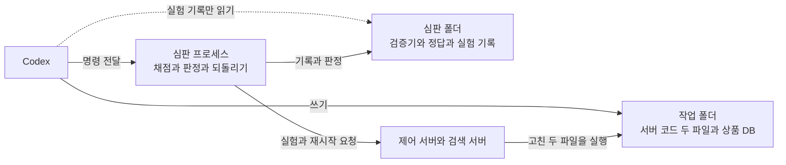

# evals

Codex가 문제를 얼마나 잘 해결하는지 재는 폴더다. `tests/`는 우리가 만든 프로그램이 맞게 동작하는지 확인하고 이 폴더는 에이전트의 결과를 평가한다.

반복 평가를 돌린 결과는 아직 없다. 지금까지의 실제 실행은 상태마다 한 번씩이고 기록은 [`../docs/load-scenario-plan.md`](../docs/load-scenario-plan.md)의 13번부터 17번에 있다. 그 실행들은 아래의 권한 분리를 적용하기 전에 한 것이다.

## 구성

| 파일 | 역할 |
|---|---|
| [`make_workspace.py`](make_workspace.py) | 심판 폴더와 에이전트의 작업 폴더를 따로 만든다 |
| [`judge.py`](judge.py) | 심판 프로세스. 작업 폴더에서 온 명령을 심판 폴더의 실험 도구로 실행한다 |
| [`runner.py`](runner.py) | 평가 한 번을 처음부터 끝까지 실행한다 |
| [`score_run.py`](score_run.py) | Codex 실행 기록과 작업 폴더에서 지표를 계산한다 |

## 두 폴더로 나누는 이유

원본 저장소에는 원인과 해결책이 적혀 있다. 답이 보이는 상태에서 실행했을 때 Codex는 저장소에 있던 인덱스 정의를 그대로 실행했다. 또 검증기와 정답과 실험 기록이 에이전트와 같은 폴더에 있으면 에이전트가 그것을 고쳐 쓸 수 있다.

그래서 에이전트가 고칠 수 있는 영역과 검증 쪽이 관리하는 영역을 폴더와 권한으로 나눈다.



| 영역 | 들어 있는 것 | Codex의 권한 |
|---|---|---|
| 작업 폴더의 `backend/catalog.py` `backend/target.py` `data/catalog.sqlite` | 고칠 대상 | 읽기와 쓰기 |
| 작업 폴더의 나머지 | 안내 문서, Skill, 읽기용 서버 코드, 명령 전달 코드 | 읽기. Skill과 `AGENTS.md`와 명령 전달 코드는 쓰기 거부 |
| 심판 폴더의 `data/runs/` | 실험 기록 | 읽기만 |
| 심판 폴더의 나머지 | 검증기, 정책, 결함 파일, 테스트, 실험 묶음 기록, 되돌리기용 복사본 | 읽기와 쓰기 모두 거부 |
| 원본 저장소와 홈 폴더 | 답이 적힌 문서와 코드 | 읽기와 쓰기 모두 거부 |

- 권한은 Codex의 권한 프로필로 건다. 전체 디스크 읽기를 끄고 필요한 경로만 연다. 설정은 [`runner.py`](runner.py)의 `permissions`에 있고 실행할 때만 적용한다. 사용자의 Codex 설정 파일은 바꾸지 않는다.
- 작업 폴더의 `agent_bridge`는 명령을 심판 프로세스에 전달하는 코드 한 파일이다. 판정 로직이 없어서 고쳐도 판정이 바뀌지 않는다.
- 심판 폴더의 검색 서버는 작업 폴더의 두 파일을 링크로 가리켜 그대로 실행한다. 에이전트가 서버에 영향을 주는 길은 그 두 파일과 DB 구조뿐이다.
- 심판 프로세스는 `snapshot` `adopt` `replay` `run` `verify` `status` `logs` `scope` `restart` `compare` `rollback` `progress`만 받는다.

확인한 것: 위 권한을 건 샌드박스에서 직접 시험했다. 심판 폴더의 검증기 읽기, 원본 저장소 읽기, 실험 기록 쓰기, 실험 묶음 기록 쓰기, Skill 쓰기, 명령 전달 코드 쓰기가 모두 거부됐다. 같은 권한에서 넘겨받기부터 재실험과 재시작과 비교와 되돌리기까지 끝까지 실행됐다.

남은 한계

- 위 시험은 Codex의 샌드박스 명령으로 한 것이다. `codex exec`가 같은 권한을 적용하는지는 실제 실행의 기록으로 확인해야 한다.
- 시스템 임시 폴더(`/tmp`)는 쓸 수 있다. 평가 폴더가 임시 폴더 아래에 있어도 경로를 지정해 거부하므로 심판 폴더는 보호된다.
- 에이전트는 제어 서버의 API를 직접 부를 수 있다. 실험을 따로 시작하거나 서버를 재시작할 수 있지만 정답과 실험 묶음 기록은 바꾸지 못한다.
- 기준 정답 파일은 실험 기록 폴더에 있어 읽을 수 있다. 검색 결과의 목록이고 고치는 방법은 들어 있지 않다.
- 사용자의 Codex 전역 설정과 전역 Skill은 그대로 읽힌다. 실행마다 입력이 큰 이유 중 하나일 수 있다.

## 실행

모든 실행은 새 폴더와 새 Codex 세션에서 시작한다. Codex 실행은 유료다.

```bash
# Codex 없이 폴더 생성과 서버 시작과 유입까지만 확인
.venv/bin/python -B -m evals.runner a /path/to/eval/a-01 --catalog data/demo-1m/catalog.sqlite --skip-agent

# 평가 한 번
.venv/bin/python -B -m evals.runner a /path/to/eval/a-01 --catalog data/demo-1m/catalog.sqlite --effort medium --timeout 900
```

`runner.py`가 하는 일

1. 심판 폴더와 작업 폴더를 만든다.
2. 심판 폴더에서 제어 서버와 심판 프로세스를 켠다. 포트는 `--port`부터 세 개를 쓴다.
3. 무작위 조건으로 유입을 한 번 보낸다. 사람이 화면에서 보내는 유입을 대신한다. 측정이 무효면 세 번까지 다시 보낸다.
4. 권한 프로필을 걸어 `codex exec`를 실행한다. `--timeout` 초가 지나면 중단한다.
5. 실행 기록을 채점하고 심판 폴더가 바뀌지 않았는지 확인한다.
6. 서버를 끄고 결과를 평가 폴더의 `result.json`에 쓴다. 실행 기록은 `codex.jsonl`이다.

여러 번 반복해 결과를 모으는 기능과 토큰 사용량 한도는 만들지 않았다. 한 번에 한 실행이고 한도는 실행 시간으로만 건다.

## 지표

`score_run.py`는 Codex의 최종 설명을 읽지 않는다. 기록된 명령과 그 출력과 작업 폴더의 변경만 본다.

| 지표 | 계산 방법 |
|---|---|
| `passed` | 문제 상태는 `compare`의 마지막 판정이 `accept`이고 새 요청의 판정이 `healthy`이고 허용 범위 밖의 변경이 없다. 정상 상태는 변경이 없고 판정이 `healthy`다. 심판 폴더가 바뀌었거나 시간 한도를 넘으면 통과가 아니다 |
| `accepted_first_try` | 첫 `compare`가 `accept`다 |
| `attempts` | `compare`를 실행한 횟수 |
| `changed_outside_allowed` | 허용한 두 파일 밖에서 바뀐 파일 |
| `judge_changed` | 심판 폴더에서 바뀐 파일. 비어 있어야 한다 |
| `hypothesis_before_edit` | 가설을 남긴 `progress`가 첫 파일 수정보다 먼저다 |
| `sent_own_first_load` | 넘겨받지 않고 직접 첫 유입을 보냈다 |
| `commands`와 `failed_commands` | 실행한 명령 수와 실패한 명령 수 |
| `elapsed_s`와 `timed_out` | 걸린 시간과 시간 한도 초과 여부 |
| `input_tokens` `cached_input_tokens` `output_tokens` | 실행 기록의 사용량. 청구액은 이 기록으로 알 수 없다 |

재지 않는 것: 측정 오류를 발견하는 비율은 측정이 무효인 상태를 만드는 출발 상태가 없어 잴 수 없다. 근거의 질을 사람이 읽고 매기는 채점은 넣지 않았다.

입력 토큰에 대해: 앞선 실행은 입력이 약 80만 토큰이었고 그중 약 96%가 캐시 입력이었다. Codex는 명령을 한 번 실행할 때마다 그때까지의 대화를 다시 입력으로 보낸다. 명령이 약 20개였으므로 한 번에 약 4만 토큰이 20번 넘게 더해진 값으로 보인다. 긴 출력을 반복해서 읽었는지는 실행 기록의 명령별 출력 길이로 확인할 수 있지만 아직 확인하지 않았다.

## 사전 가설 규칙의 효과 비교

스터디에서 얻은 규칙은 고치기 전에 가설과 예상 결과와 기각 조건을 적는 것이다. 이 규칙이 결과를 바꾸는지 보려면 두 집단을 비교한다.

| 집단 | 실행 |
|---|---|
| Study Rules | `evals.runner <상태> <폴더> --catalog <DB>` |
| Baseline | `evals.runner <상태> <폴더> --catalog <DB> --rules baseline` |

`--rules baseline`은 Skill에서 사전 가설 단계만 뺀다. 그 단계는 `SKILL.md`에서 `study-rule` 표시 사이에 있다. 나머지 절차와 모델과 생각 단계와 도구와 권한과 초기 코드와 DB와 채점은 같다. 유입 조건을 같게 하려면 두 집단에 같은 `--seed`를 준다.

정해야 할 것

- 상태마다 집단마다 몇 번 실행할지와 쓸 한도.
- 지금까지 세 상태 모두 첫 시도에 통과했다. 두 집단의 차이를 보려면 더 어려운 출발 상태가 필요할 수 있다.
